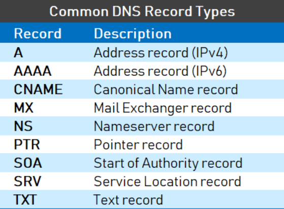
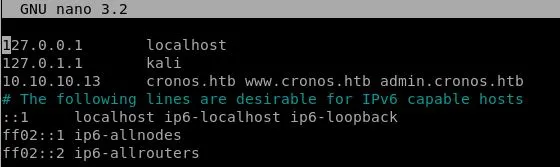
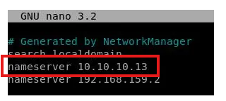
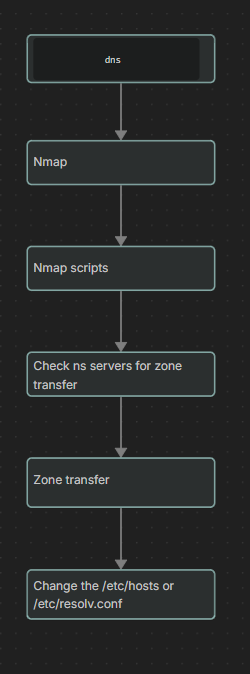

DNS (Domain Name System) works on port 53.

## General information

Hosts file paths:

```text
C:\Windows\System32\drivers\etc\hosts
/etc/hosts
```



## Check open ports

```bash
nmap -p53 <ip>
```

## Nmap scripts

```bash
# Service and version detection
nmap -p53 -sVC -A <ip>

# DNS zone transfer script
nmap -p53 --script dns-zone-transfer <ip>
```

<Note>
  You have to find the domain in order to be able to perform enumeration on the DNS, so try to gather information using ldap, dns ns, nmap scripts.
</Note>

## Check NS server

```bash
host -t ns <ip-or-domain>
```

## Zone transfer

```bash
dig axfr <domain> @<ip>
```

## Add the domain or NS

Add the domains and subdomains to the `/etc/hosts` file.



Add the NS to the `/etc/resolv.conf` file.



## Steps



## Dangerous settings

| Setting | Description |
| --- | --- |
| `allow-query` | Defines which hosts are allowed to send requests to the DNS server. |
| `allow-recursion` | Defines which hosts are allowed to send recursive requests to the DNS server. |
| `allow-transfer` | Defines which hosts are allowed to receive zone transfers from the DNS server. |
| `zone-statistics` | Collects statistical data of zones. |

## Useful commands and tools

```bash
# IPv4 records
dig a <domain>

# IPv6 records
dig aaaa <domain>

# Name servers
dig ns <domain>

# Mail servers
dig mx <domain>

# Start of authority
dig soa <domain>

# Any available information
dig any <domain> @<ip>

# Zone transfer (subdomains)
dig axfr <domain> @<ip>

# Server version
dig version.bind <domain> @<ip>

# Brute force subdomains
dnsenum --enum inlanefreight.com -f /usr/share/seclists/Discovery/DNS/subdomains-top1million-110000.txt -r
```

<Note>
  dnsenum can be given short or quiet output flags for a shorter answer.
</Note>
