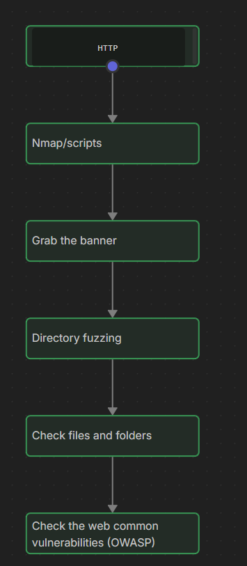

HTTP/S (Hypertext Transfer Protocol) runs on ports 80 and 443.

<Warning>
  Only run these commands against systems you own or have explicit written authorization to test.
</Warning>

## Default and error pages

- Default pages can reveal the installed service and sometimes its version.
- A 404 page can also leak information about the service and web server.

## Banner grabbing

```bash
nmap -sV -p80,443 <ip>
nc -nv <ip> 80
http <ip>
```

## Feroxbuster

```bash
# Basic scan
feroxbuster -u http://<ip>

# With a wordlist
feroxbuster -u http://<ip> -w <wordlist_file>

# With 50 threads
feroxbuster -u http://<ip> -w <wordlist_file> -t 50

# Ignore TLS errors
feroxbuster -u http://<ip> --insecure -w <wordlist_file>

# Save output to a file
feroxbuster -u http://<ip> -o <file_name>

# Combined options
feroxbuster -u http://<ip> -w <wordlist_file> --insecure -t 50 -o <filename.txt>
```

## Brute force vhost

```bash
gobuster vhost -u http://<target_IP_address> -w <wordlist_file> --append-domain
```

## Dirbuster

After the scan completes, use **Save Output** to export results in your preferred format.

## Nikto

Web vulnerability scanner.

```bash
# Basic scan
nikto -h http://<victim_ip>/

# Save output as text
nikto -h http://<victim_ip>/ -o scan_results.txt

# Save output as HTML
nikto -h http://<victim_ip>/ -o scan_results.html
```

## Burpsuite functions

- **Repeater** to modify the request and resend it.
- **Target scope** is to filter out that target from other hosts.
- **Server header** might include some important info.

## Steps


