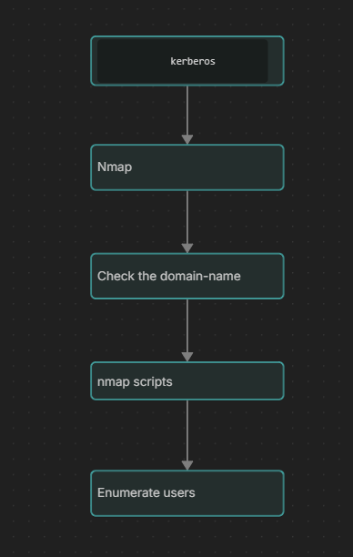

Kerberos is an authentication protocol that runs on TCP/UDP port 88.

## Port scan

```sh
# Check if port 88 is open
nmap -p88 $ip
```

## Check domain name

```sh
netexec ldap $ip
```

## Nmap scripts

```sh
sudo nmap -p88 -sVC -A $ip
```

## Enumerate users

```sh
# kerbrute user enumeration
kerbrute userenum -d domain.local --dc $ip user_list.txt
```

```sh
# Metasploit auxiliary module
use auxiliary/gather/kerberos_enumusers
# set user_file, rhosts, and domainname
```

## Steps


