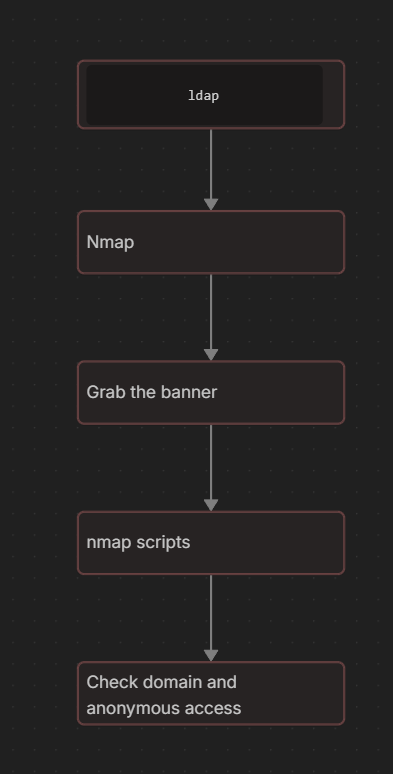

Lightweight Directory Access Protocol (LDAP) uses ports 389 and 636. Ports 3268 and 3269 are used for Global Catalog queries in Active Directory.

## Check default open ports

```sh
nmap -p 389,636,3268,3269 $ip
```

## Banner grabbing

```sh
nmap -p 389,636,3268,3269 -sV $ip
nxc ldap $ip
```

## Nmap scripts

```sh
sudo nmap -p 389,636,3268,3269 -sVC -A $ip
sudo nmap -p 389,636,3268,3269 --script ldap-rootdse $ip
```

## Anonymous access

```sh
nmap -p 389,636,3268,3269 --script ldap-rootdse $ip
ldapsearch -x -H ldap://$ip -b "DC=example,DC=com" "(objectClass=person)" cn
```

## Steps


