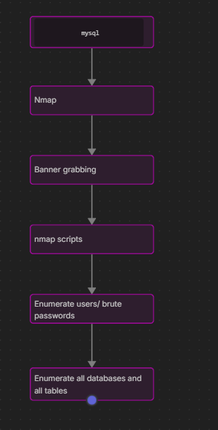

MySQL is a structured query language database that runs on port 3306.

<Warning>
  Only run brute-force and hashdump actions against systems you are authorized to test.
</Warning>

## Nmap

```sh
nmap -p3306 <ip>
```

## Banner grabbing

```sh
telnet <ip> 3306
nc -nv <ip> 3306
```

## Nmap scripts

```sh
sudo nmap -p3306 --script=mysql-info <ip>
sudo nmap <ip> -p3306 -sVC --script mysql*
sudo nmap -p3306 -sVC -A <ip>
```

## Users enumeration and brute force

```sh
# Check default credentials
mysql -h <ip> -u root -p

# Work around SSL certificate chain errors
mysql -h $ip -u user -ppassword --ssl-verify-server-cert=FALSE

# Brute force usernames and passwords
hydra -L users.txt -P pass.txt <ip> mysql
```

## Database enumeration

### Metasploit modules

```text
use auxiliary/admin/mysql/mysql_sql
use auxiliary/scanner/mysql/mysql_schemadump
use auxiliary/scanner/mysql/mysql_hashdump
use auxiliary/admin/mysql/mysql_enum
use auxiliary/scanner/mysql/mysql_file_enum
```

### SQL statements

```sql
show databases;
use <database>;
show tables;
select * from <table_name>;
select column1, column2, column3 from <table_name>;
```

## Steps



## Dangerous Settings

| Setting | Description |
| --- | --- |
| `user` | Sets which user the MySQL service will run as. |
| `password` | Sets the password for the MySQL user. |
| `admin_address` | The IP address on which to listen for TCP/IP connections on the administrative network interface. |
| `debug` | This variable indicates the current debugging settings. |
| `sql_warnings` | This variable controls whether single-row INSERT statements produce an information string if warnings occur. |
| `secure_file_priv` | This variable is used to limit the effect of data import and export operations. |

## Commands

| Command | Description |
| --- | --- |
| `mysql -u <user> -p<password> -h <IP address>` | Connect to the MySQL server. There should **not** be a space between the `-p` flag and the password. |
| `show databases;` | Show all databases. |
| `use <database>;` | Select one of the existing databases. |
| `show tables;` | Show all available tables in the selected database. |
| `show columns from <table>;` | Show all columns in the selected table. |
| `select * from <table>;` | Show everything in the desired table. |
| `select * from <table> where <column> = "<string>";` | Search for the needed string in the desired table. |
