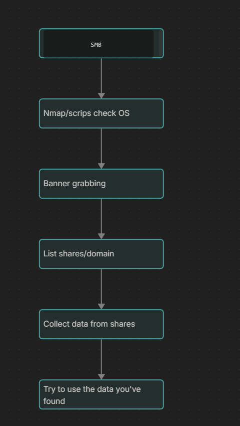

SMB (Server Message Block) runs on ports 139 and 445.

## Check version

```bash
sudo nmap -sV -p139,445 target_ip
```

## Banner grabbing

```bash
netcat -nv ip 139/445
```

## List shares

```bash
netexec smb ip -u 'anonymous' -p 'anonymous' --shares
smbclient -N -L ip
```

## Connect to a share

```bash
smbclient //IP/share -U username
smbclient -N //ip/share
rpcclient -U "" ip
```

## Download files

```bash
mget file
```

## Automated tools

```bash
enum4linux ip -A
```

## Steps



## Dangerous settings

| Setting | Description |
| --- | --- |
| `browseable = yes` | Allow listing available shares in the current share? |
| `read only = no` | Forbid the creation and modification of files? |
| `writable = yes` | Allow users to create and modify files? |
| `guest ok = yes` | Allow connecting to the service without using a password? |
| `enable privileges = yes` | Honor privileges assigned to specific SID? |
| `create mask = 0777` | What permissions must be assigned to the newly created files? |
| `directory mask = 0777` | What permissions must be assigned to the newly created directories? |

## Useful commands and tools

Lookup domain names:

```bash
impacket-samrdump ip
```

Useful commands when using `rpcclient`:

```bash
rpcclient -U "" ip
help
srvinfo
querydomaininfo
netshareenumall
```
