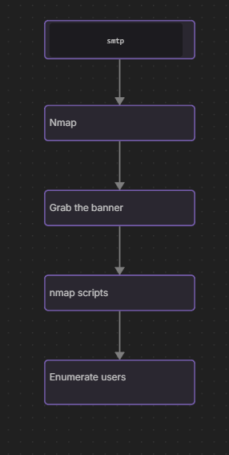

SMTP (Simple Mail Transfer Protocol) typically runs on ports 25, 587, and 465.

## Check open ports

```bash
nmap -p25,587,465 ip
```

## Banner grabbing

```bash
nc -nv ip 25
telnet ip 25
```

```text
msf auxiliary/scanner/smtp/smtp_version
```

## SMTP verb testing

```text
VRFY admin@example.com        # Directly asks if the user exists
EXPN staff-list               # Expands mailing lists (if enabled)
RCPT TO: test@example.com     # Checks if recipient is accepted

250 2.1.5 User exists → Valid user
550 5.1.1 User unknown → Invalid user
```

## Nmap scripts

```bash
sudo nmap -p25,587,465 -sVC -A ip -o nmap_all.txt
sudo nmap -p25,587,465 -sVC --script smtp-open-relay
```

<Note>
  The `smtp-open-relay` script checks whether everyone is allowed to send an email.
</Note>

## Check commands

1. Log in to SMTP and check if the `VRFY` command is allowed.
2. Perform enumeration on the SMTP service.

## Enumerate users

```bash
smtp-user-enum -M VRFY -U users.txt -t ip -w 20
```

Change `-w` if the server verification is slow.

```text
msf auxiliary/scanner/smtp/smtp_enum
```

## Steps



## Dangerous settings

```text
mynetworks = 0.0.0.0/24
```

This means everyone from other networks is allowed to send an email without firewall verification.

## Login to SMTP

```bash
telnet ip port
```

```text
ehlo domain
vrfy username
```

## Commands

| Command | Description |
| --- | --- |
| `HELO` | The client logs in with its computer name and thus starts the session. |
| `MAIL FROM` | The client names the email sender. |
| `RCPT TO` | The client names the email recipient. |
| `DATA` | The client initiates the transmission of the email. |
| `RSET` | The client aborts the initiated transmission but keeps the connection between client and server. |
| `VRFY` | The client checks if a mailbox is available for message transfer. |
| `EXPN` | The client also checks if a mailbox is available for messaging with this command. |
| `NOOP` | The client requests a response from the server to prevent disconnection due to time-out. |
| `QUIT` | The client terminates the session. |
