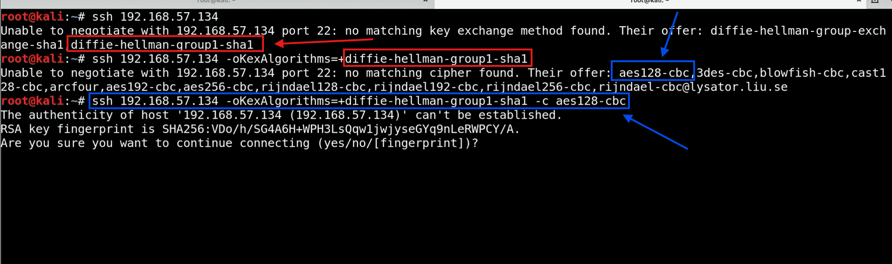
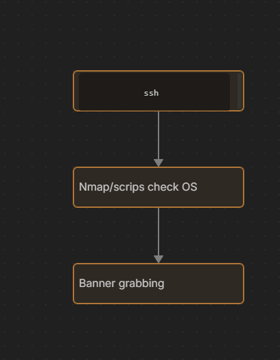

SSH (Secure Shell) typically runs on port 22.

<Warning>
  If we try to log in to SSH, even once, while it is under exploitation, it will be noticed as an exploitation. Do not log in to SSH during active exploitation.
</Warning>

## Version detection

```bash
netcat -nv ip 22
nmap -sV -p22 ip
nxc ssh 192.168.117.140 -u '' -p ''
```

## Connect to old SSH

With some old SSH versions we have to select the type of encryption and the cipher, as shown in the picture below. We first log in and get the supported encryption, then log in again to get the cipher.



```bash
ssh target_ip -oKexAlgorithms=+typeencryption -c type_cipher
```

## Steps


