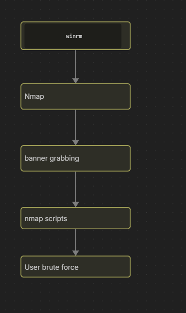

Windows Remote Management (WinRM) listens on ports 5985 (HTTP) and 5986 (HTTPS).

## Port scan

```sh
nmap -p5985,5986 $ip
```

## Banner grabbing

```sh
nc -nv $ip 5985
```

## Nmap scripts

```sh
nmap -sV -sC $ip -p5985,5986 --disable-arp-ping -n
```

## Connect to WinRM

```powershell
# Basic connection
evil-winrm -i target.com -u administrator -p 'password'

# With domain
evil-winrm -i target.com -u 'DOMAIN\username' -p 'password'

# Pass-the-Hash
evil-winrm -i target.com -u administrator -H 'NTHASH'

# SSL on port 5986
evil-winrm -i target.com -u administrator -p 'password' -S

# Custom port
evil-winrm -i target.com -u administrator -p 'password' -P 5985
```

## Steps


