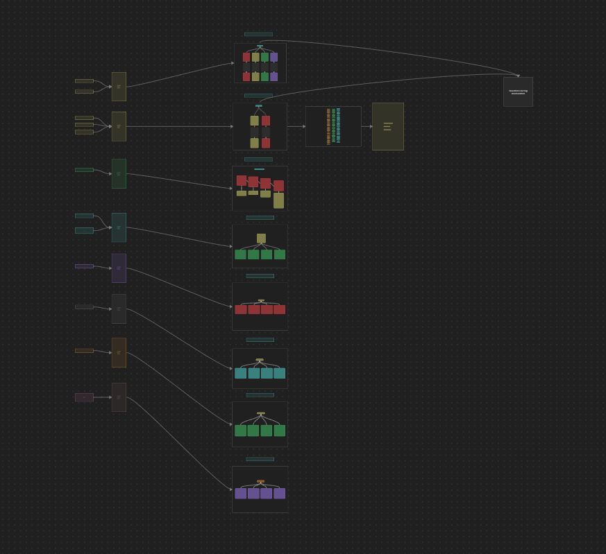

## Overview

Penetration Testing Navigator is my personal collection of notes and methodology for penetration testing. It is a practical, step-by-step methodology and cheatsheet built for CTFs, labs, and certification prep.

I built it to follow a clear process during an engagement instead of running tools at random or missing important steps.

<Card title="View on GitHub" icon="github" href="https://github.com/0101isnothacking/Penetration-testing-navigator">
  Browse the full notes, mind maps, and cheatsheets in the repository.
</Card>

## Methodology

The navigator follows eight phases, from first contact with a target to the final report.

<Steps>
  <Step title="Recon">
    Find domains, IP addresses, and other information about the target.
  </Step>
  <Step title="Enumeration">
    Scan ports and check the services running on them.
  </Step>
  <Step title="Vulnerability assessment">
    Look for outdated software and misconfigurations.
  </Step>
  <Step title="Exploitation">
    Gain initial access to the target.
  </Step>
  <Step title="Post-exploitation">
    Explore the system and collect useful information.
  </Step>
  <Step title="Privilege escalation">
    Look for ways to become root or SYSTEM.
  </Step>
  <Step title="Pivoting">
    Access other systems or networks from the compromised host.
  </Step>
  <Step title="Reporting">
    Document what was found and how it was done.
  </Step>
</Steps>

## Mind map

The notes are organized as a connected mind map in Obsidian, linking each phase to its techniques and commands.

<Frame caption="Penetration Testing Navigator mind map in Obsidian">
  
</Frame>

## How to use it

1. Clone the repository:
   ```bash
   git clone https://github.com/0101isnothacking/Penetration-testing-navigator.git
   ```
2. Rename the `obsidian` folder to `.obsidian`.
3. Open the folder in [Obsidian](https://obsidian.md) to use the notes and mind maps.

## Goal

Keep things simple, stay organized, and avoid missing important steps during testing.
