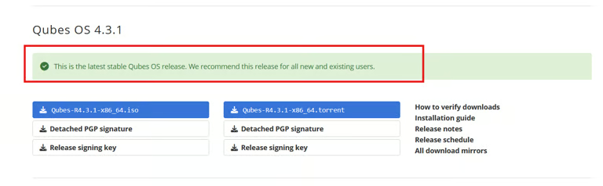
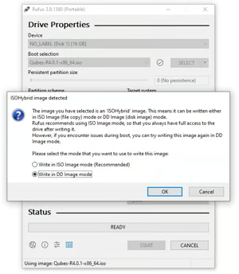
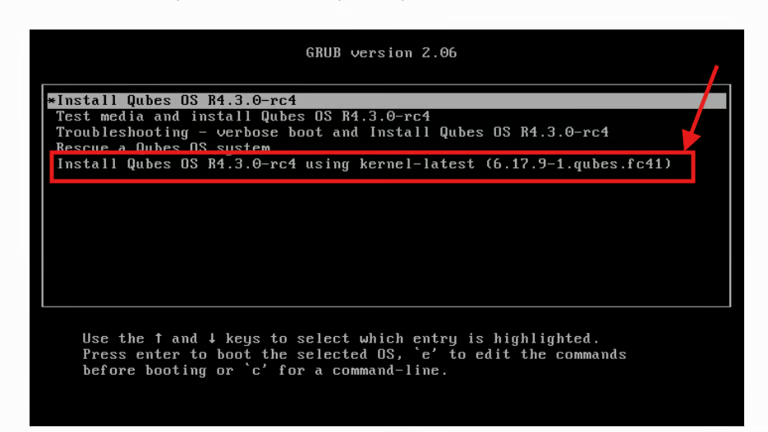
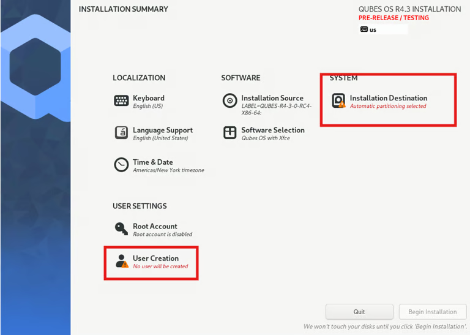
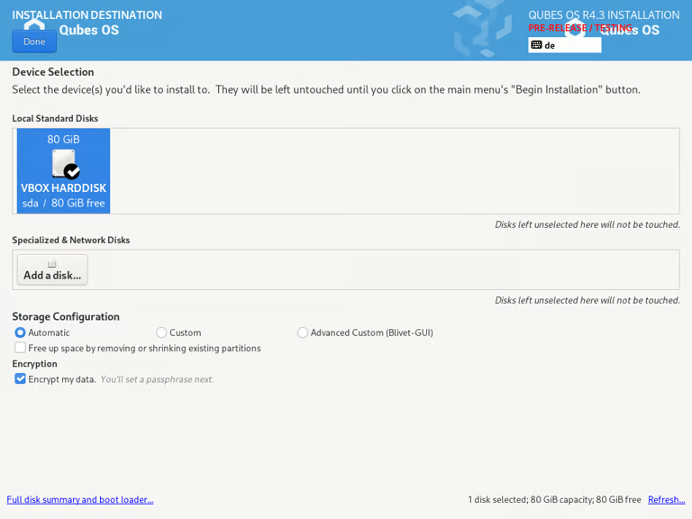
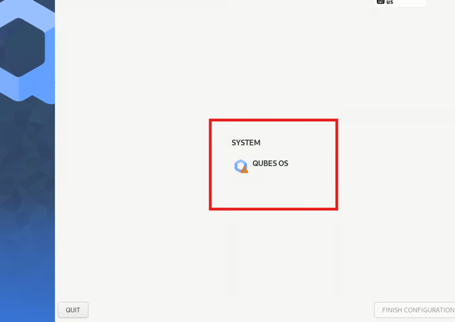
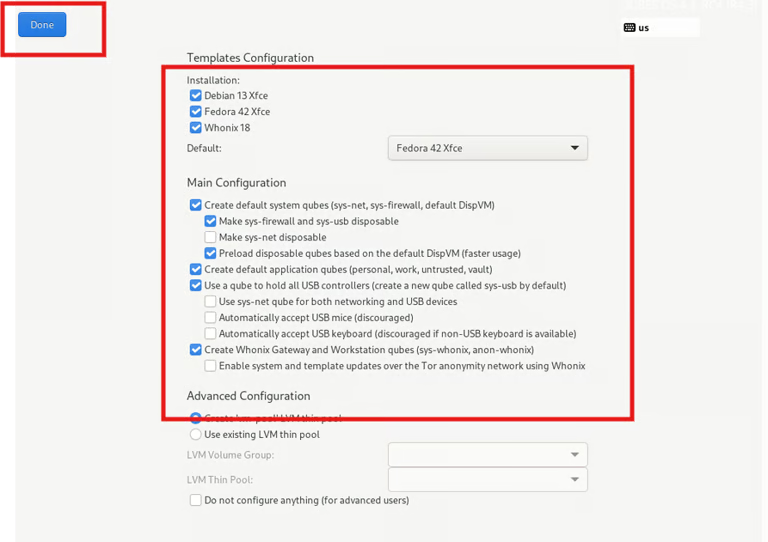

## Introduction

Qubes OS is a security-focused operating system used by many security professionals and penetration testers. It runs everything in separate, isolated virtual machines called **qubes**. Each application, terminal and operating system runs in its own private environment, so a compromise in one qube does not spread to the others.

This page covers the hardware requirements and a step-by-step installation from a USB stick.

## Requirements

| Component | Minimum requirement |
| --- | --- |
| **CPU** | 64-bit Intel or AMD processor (x86_64, x64, AMD64) |
| **Virtualization** | Intel VT-x with EPT, or AMD-V with RVI |
| **IOMMU** | Intel VT-d, or AMD-Vi (AMD IOMMU) |
| **Memory** | 6 GB RAM |
| **Storage** | 32 GB free space |

<Tip>
  Always check the official [system requirements](https://doc.qubes-os.org/en/latest/user/hardware/system-requirements.html) before you install, since they can change between releases.
</Tip>

## Installation

<Steps>
  <Step title="Download Qubes OS">
    Download the **stable** release ISO from the [Qubes OS downloads page](https://www.qubes-os.org/downloads/).

    <Frame>
      
    </Frame>
  </Step>
  <Step title="Install Rufus">
    Download and install [Rufus](https://rufus.ie/), which you use to write the ISO to a USB stick.
  </Step>
  <Step title="Create the bootable USB stick">
    Open Rufus, select your USB stick and the Qubes OS ISO, then start writing.

    <Warning>
      When Rufus asks how to write the image, select **Write in DD Image mode**. Other modes can cause errors during installation.
    </Warning>

    <Frame>
      
    </Frame>
  </Step>
  <Step title="Configure your BIOS">
    Restart your computer, open the BIOS or UEFI settings, and:

    - Enable virtualization.
    - Disable Secure Boot.
    - Set the computer to boot from the USB stick.
  </Step>
  <Step title="Start the installer">
    In the GRUB boot menu, select the last option: **Install Qubes OS using kernel-latest**.

    <Frame>
      
    </Frame>

    On the **Installation Summary** screen, open each highlighted item (**Installation Destination** and **User Creation**) to configure it.

    <Frame>
      
    </Frame>
  </Step>
  <Step title="Select and encrypt the disk">
    Select the disk to install on and enable the **Encrypt my data** checkbox.

    <Frame>
      
    </Frame>
  </Step>
  <Step title="Open the Qubes OS configuration">
    After the installation finishes and the system reboots, click **Qubes OS** under **System** to configure the environment.

    <Frame>
      
    </Frame>
  </Step>
  <Step title="Choose templates and default qubes">
    Select the templates (for example Debian, Fedora, and Whonix) and the default system and application qubes you want, then click **Done** in the top-left corner.

    <Frame>
      
    </Frame>
  </Step>
</Steps>
