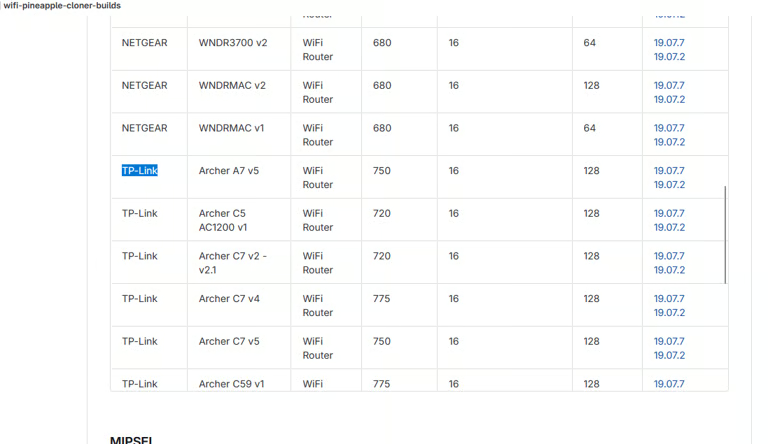
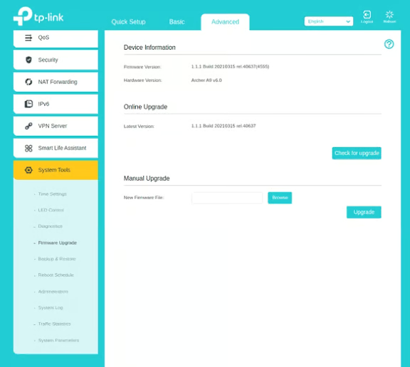
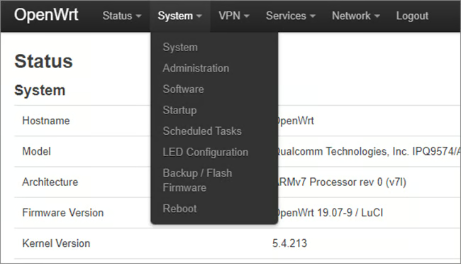
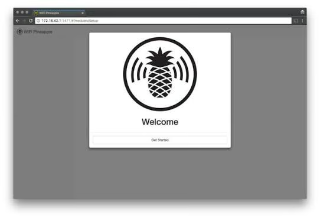

## Overview

This project turns an old, inexpensive router into a homemade WiFi Pineapple by flashing OpenWrt and then the WiFi Pineapple cloner firmware.

<Warning>
  This project involves security techniques that can be dangerous and is not a toy. Understand the risks fully before using it. You are responsible for your own use: do not run any attack against networks or devices you do not own or have explicit permission to test.
</Warning>

## Hardware requirements

<Card title="Check compatibility first" icon="wifi" href="https://firmware-selector.openwrt.org/">
  Use the OpenWrt firmware selector to confirm your router supports custom firmware and is not locked down.
</Card>

- **Router:** An OpenWrt-compatible model with unlocked firmware. This guide uses the **TP-Link Archer AC1750 v5**.
- **USB stick:** 16 GB or larger, used to expand the router's storage.

## Installation

<Steps>
  <Step title="Download OpenWrt 19.07.7">
    Install OpenWrt **19.07.7**, the firmware version supported by the WiFi Pineapple cloner project.

    [Download from the OpenWrt archive](https://archive.openwrt.org/releases/)
  </Step>
  <Step title="Find your router build">
    Look up your router model and version and grab the **19.07.02** build for it.

    [WiFi Pineapple cloner builds](https://gitlab.com/xchwarze/wifi-pineapple-cloner-builds)

    
  </Step>
  <Step title="Flash the OpenWrt firmware">
    Depending on your router model and version, find the system upgrade option and upload the OpenWrt `.bin` firmware.

    
  </Step>
  <Step title="Flash the WiFi Pineapple firmware">
    After uploading the OpenWrt `.bin` file, wait about 5-10 minutes. Then open the OpenWrt GUI at `192.168.1.1`.

    <Note>
      You will receive an IP address from the DHCP service running on OpenWrt.
    </Note>

    Go to **Backup / Flash Firmware** and upload the WiFi Pineapple firmware.

    
  </Step>
  <Step title="Open the WiFi Pineapple interface">
    Wait about 5-10 minutes until the device issues a new IP address.

    <Note>
      Manage the router at [172.16.42.1:1471](http://172.16.42.1:1471/).
    </Note>

    Complete the default configuration based on your goals and setup.

    
  </Step>
  <Step title="Expand storage with the USB stick">
    Connect to the WiFi Pineapple over SSH with your credentials, plug in the USB stick, and copy the whole overlay to it.

    ```sh
    # Install packages
    opkg update
    opkg install block-mount kmod-usb-storage kmod-fs-ext4 e2fsprogs
    
    # Check your USB partition. Change sda1 to match your stick's name.
    block info
    ls -l /dev/sda1
    df -h
    
    # Mount /overlay to the USB stick
    mkdir -p /mnt/usb
    mount /dev/sda1 /mnt/usb
    tar -C /overlay -cf - . | tar -C /mnt/usb -xf -
    sync
    umount /mnt/usb
    
    # Add the USB to the startup config
    block detect > /etc/config/fstab
    
    # Open the file
    vi /etc/config/fstab
    ```

    Update the mount section in `/etc/config/fstab`:

    ```text
    config mount
            option target '/overlay'
            option uuid 'YOUR-USB-PARTITION-UUID'
            option fstype 'ext4'
            option options 'rw,noatime'
            option enabled '1'
            option enabled_fsck '0'
    ```

    Reboot and verify that `/overlay` is backed by the USB partition and that its available space has increased:

    ```sh
    reboot
    df -h
    ```
  </Step>
  <Step title="Install modules and go">
    Connect the device to the internet, open the **Modules** section, and install the modules you want. Have fun.
  </Step>
</Steps>
